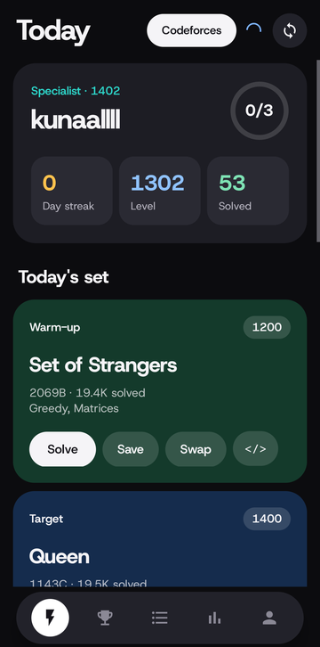
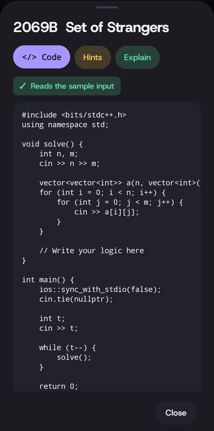
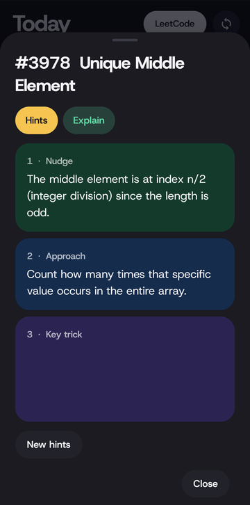
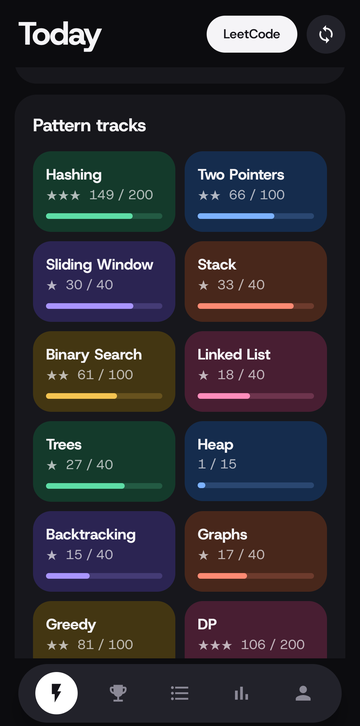
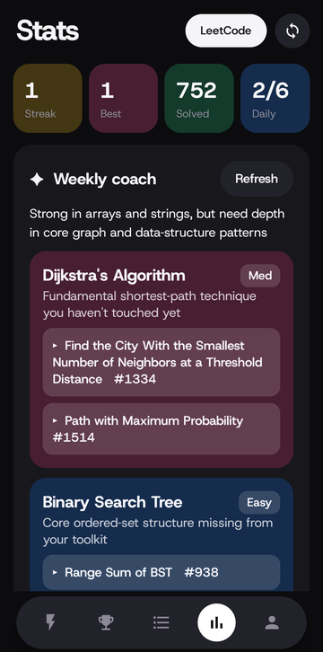

<div align="center">

# Upsolve

**A daily practice coach for Codeforces and LeetCode, in your pocket.**

Three hand-picked problems a day, C++ templates that already read the input, AI hints that never spoil the answer, and a coach that tells you what to train next.

[](https://github.com/kunal-shetty/codeforces/actions/workflows/build.yml)
[](LICENSE)


[](CONTRIBUTING.md)

[Download](#install) · [Features](#features) · [Build from source](#build-from-source) · [Contributing](CONTRIBUTING.md)

</div>

<p align="center">
  
  
  
  
  
</p>

---

## Why

Practice works when it's daily, at the right level, and aimed at your weak spots. Upsolve handles the "what should I solve next?" part: it picks problems near your level, leans on the topics you're weakest at, writes the boring input code, and keeps a streak going. You open the app, solve, and get better.

## Features

### Every day
- **Today's set**: three unsolved picks (warm-up, target and stretch) near your level, weighted toward your weaker tags. You can swap or save a pick. In LeetCode mode the official daily problem joins as a fourth card.
- **Streaks and reminders**: a daily notification at a time you choose, plus an evening nudge if your streak is at risk.
- **Solve again from memory**: problems you solved about 2 weeks ago come back, then again after about 6 weeks. Mark one done or push it back a week.
- **Trick cards**: the key idea behind each problem becomes a flashcard. It comes from AI hints, the AI editorial or your own notes. Recall the trick, flip the card, and grade yourself; cards come back after 1 → 3 → 7 → 16 → 35 → 80 days.
- **Home-screen widget**: progress ring, streak, today's problems, the next problem to solve again, and cards due.

### Codeforces
- **C++ templates** (the `</>` button) with the input already read: single values, arrays, strings, grids, matrices, tree and graph edges turned into an adjacency list, query loops and the test-case loop. Adds `long long` when the limits need it, a `MOD` constant when the output mentions one, and a YES/NO hint. You only write the logic in `solve()`.
  - The reading code is checked by running it on the sample input. ✓ means every sample token lined up; ⚠ means look over the reading part (mostly typed queries).
  - Put your own `#include`s and macros on top with **Profile → My template**.
- **Contests**: upcoming rounds with countdowns and reminders exactly 30 minutes before, plus past rounds you haven't tried, for virtual contests.
- **Problems**: search and filter by rating, tag, unsolved, saved, and **upsolve** (tried but not yet solved). Hold a problem to add a note.
- **Topic ladder**: one problem per rating step for a chosen tag.

### LeetCode
- **Pattern tracks**: 16 patterns (hashing, two pointers, sliding window, stack, binary search, trees, heap, graphs, DP and more), each with progress tiers 15 → 40 → 100 → 200 → 400. Tap a tile for the next unsolved problems from Easy to Hard.
- Daily picks, saved problems, notes, heatmap, contest rating graph and a friends leaderboard, all from your public profile.

### AI coach (optional, free)
Runs on [Groq](https://console.groq.com)'s free tier with open models. You paste your own key; it never leaves your phone except in calls to Groq.

- **Hints**: three steps (a nudge, the approach, the key trick), each hidden until you tap it. They never include code.
- **Explain**: the solution in five lines, its time complexity and the one idea to remember, behind a spoiler tap.
- **Weekly coach** (Stats tab): reads your per-tag record and picks three topics to train. The app then fills each topic with real unsolved problems at the right level.

### Stats
Streak tiles, an activity heatmap, solved counts by rating or difficulty, a rating graph, tag strengths, and the history of past picks.

## Install

1. Download the latest `Upsolve-*.apk` from [**Releases**](https://github.com/kunal-shetty/codeforces/releases).
2. Open it on your phone and allow installs from that source when Android asks.
3. In the app, open **Profile**, enter your Codeforces handle (or switch the top pill to LeetCode and enter your username), and tap **Sync**.
4. Optional: tap **Get a free key** in Profile → AI coach, create a key at console.groq.com, paste it, and tap **Save**.

Requires Android 8.0 (API 26) or newer.

## Build from source

```bash
git clone https://github.com/kunal-shetty/codeforces.git
cd codeforces
./gradlew assembleDebug        # Windows: gradlew.bat assembleDebug
```

The APK lands in `app/build/outputs/apk/debug/`. Install it with `adb install -r app/build/outputs/apk/debug/app-debug.apk`, or open the folder in Android Studio and press Run.

| Tool | Version |
|---|---|
| JDK | 17 or newer |
| Android Gradle Plugin | 8.11.1 |
| Gradle (wrapper) | 8.14.3 |
| compileSdk / targetSdk / minSdk | 36 / 34 / 26 |

## How it works

| Piece | What it does |
|---|---|
| **Recommender** | Estimates your level from recent solves (or your LeetCode contest rating), then picks unsolved problems at three offsets, weighted toward tags with a high fail ratio or little exposure. |
| **Template generator** | Fetches the statement, reads the *Input* section sentence by sentence (newer `$$$…$$$` math and older `tex-span` markup), builds a reading plan, then replays it on every sample. Tested on 102 real problems: 101 read their samples exactly and all 102 compile with g++. |
| **AI** | Plain HTTPS calls to Groq's OpenAI-compatible endpoint. If the default model (`openai/gpt-oss-120b`) is retired, the app picks the best chat model your account lists. Answers are cached per problem, so opening them again is free. |
| **Sync** | Codeforces REST API and LeetCode's public GraphQL. Coming back from the browser triggers a quick check, so a fresh Accepted shows up on its own. |
| **Storage** | SQLite: one database per site, kept only on the phone. |

### Design principles
- **No third-party libraries.** Pure Java and Android XML. The APK is about 330 KB.
- **Colourful and low on text.** Cards, icons, charts and bottom sheets rather than dialogs, in both light and dark themes.
- **Private by default.** No accounts, analytics or servers of its own.

## Project structure

```
app/src/main/java/com/kun/cfdaily/
├── data/                     everything that isn't UI
│   ├── Db.java               SQLite: problems, solves, picks, notes, cards, revisits
│   ├── CfApi.java            Codeforces REST client (handles rate limits)
│   ├── LcApi.java            LeetCode GraphQL client
│   ├── Sync.java, LcSync.java
│   ├── Recommender.java      daily picks and topic ladder
│   ├── Template.java         Input-section parser and C++ generator
│   ├── Ai.java               Groq client
│   └── Reminders.java, *Receiver.java
└── ui/
    ├── MainActivity.java     tabs, bottom sheet, snackbar
    ├── TodayScreen, ContestsScreen, ProblemsScreen, StatsScreen, ProfileScreen
    ├── ProblemSheet.java     Code / Hints / Explain
    ├── Coach.java, Tracks.java, Flashcards.java
    ├── TodayWidget.java
    └── HeatmapView, RatingBarsView, RatingGraphView, RingView, ...
tools/template-check/         desktop harness for the template generator
```

## Privacy

- Your handle, solves, notes and cards are stored only on your phone.
- Your Groq key is kept in the app's private storage and sent only to `api.groq.com`.
- AI requests contain the problem statement, plus your tag stats for the coach. They never include personal data.
- The app has no analytics or tracking.

## Known limits

- **LeetCode** only exposes your 20 most recent accepted submissions, so Upsolve's list of your LeetCode solves grows from the day you add your username. Older solves can show up as picks or in tracks; just swap them. LeetCode's profile has no per-tag counts for Heap or Prefix Sum, so those tracks undercount.
- **AI** answers come from open models and can be wrong. Treat them as a study partner, not the official editorial.
- **Templates** cover common input shapes. Typed queries ("1 x" / "2 l r") leave a marked spot for you to finish.

## Contributing

Contributions are welcome: bug reports, new template patterns, UI polish, translations and new features. Start with [**CONTRIBUTING.md**](CONTRIBUTING.md), and look for issues labelled [`good first issue`](https://github.com/kunal-shetty/codeforces/labels/good%20first%20issue).

Please read the [Code of Conduct](CODE_OF_CONDUCT.md). To report a security problem, see [SECURITY.md](SECURITY.md).

## License

[MIT](LICENSE) © Kunal Shetty and contributors. The bundled Host Grotesk font is under the SIL Open Font License; see [NOTICE.md](NOTICE.md).

Upsolve is not affiliated with Codeforces, LeetCode or Groq.
